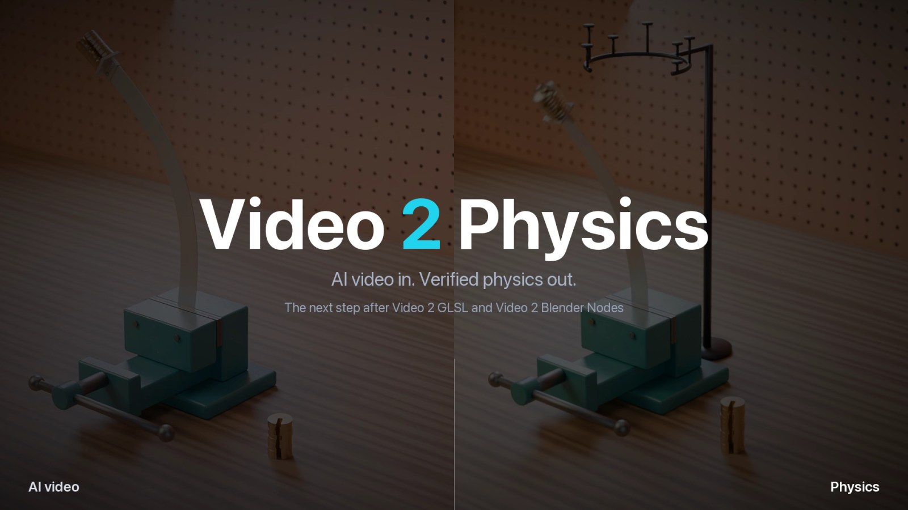
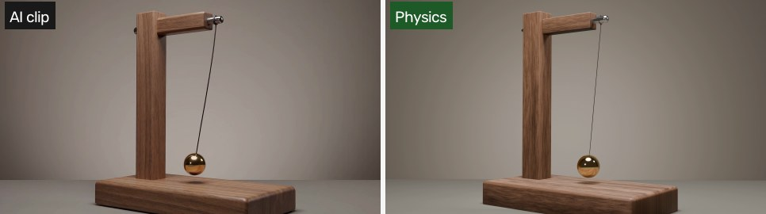
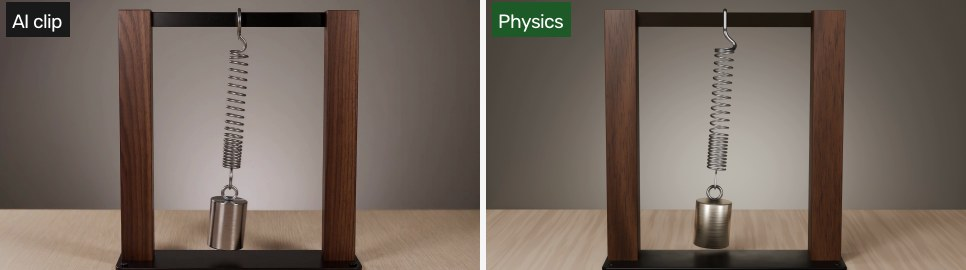
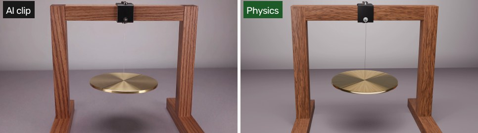
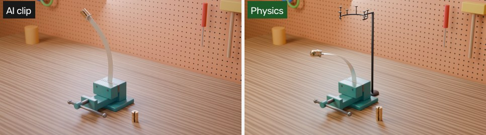
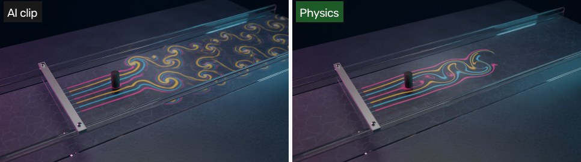

# Video 2 Physics

**Turn a reference video, image or idea into a verified physics reconstruction in Blender.** A skill for coding
agents (Claude Code, Codex, Cursor, Copilot, Gemini) that measures what a clip actually shows, replaces its wrong
physics with a solved and benchmarked model, checks it with an independent verifier, and renders it in the same
scene at the same times.

<p align="center"><a href="https://v3b.fal.media/files/b/0aaff708/qFBVeL9OOVmM9wQsUWIi6_video2physics_release_v2.mp4"></a></p>

<p align="center"><a href="https://v3b.fal.media/files/b/0aaff708/qFBVeL9OOVmM9wQsUWIi6_video2physics_release_v2.mp4"><b>Watch the release video</b></a> (62 s): AI clips against corrected physics, the measurements, the benchmarks and the checks.</p>


The third step after [Video 2 GLSL](https://github.com/gokayfem/shader-skills) (a clip rebuilt as one shader) and
[Video 2 Blender Nodes](https://github.com/gokayfem/video-to-blender) (a clip rebuilt as editable node graphs).
Those keep how a scene *looks*. This one fixes how it *moves*.

## Why

Video generators are good at appearance and bad at mechanics. Measured on the five clips in
[`examples/`](examples/):

- a pendulum's swing grows by 62 % with nothing driving it;
- weights appear in mid-air, two at a time, and a buckled ruler swings to the other side under the same load;
- a vortex street plays about 3.5× too fast, with its vortex rows about three times too far apart;
- a torsion disc's sway gains energy while the camera slowly orbits;
- a spring meant to bob vertically swings sideways and its half-period drifts by 7.5 %.

Asking an agent to "fix the physics" usually fits a curve to those defects, or simulates something plausible
without checking it. This skill gives the agent a method and the tools to do it properly:

- **Measure before modelling.** Camera stability, rectification of the motion plane (including refraction through
  water or glass), tracks with uncertainties, and a list of what the footage does that physics cannot.
- **A declared model.** Every parameter is labelled *measured*, *declared*, *assumed*, *fitted* or
  *model-conditioned*. Only the physically behaving opening of a clip is used as an anchor, and the anchored
  choice is stated.
- **Benchmarks first, then convergence.** Solvers are checked against closed forms and published results (Euler
  buckling, the elastica, Schäfer–Turek flow past a cylinder, Williamson's Strouhal curve) and then run on three
  resolutions, with energy and mass budgets.
- **An independent verifier.** A second implementation that shares no code re-derives the key numbers, and
  deliberately wrong inputs (negative controls) must fail the checks.
- **The render does what the solver says.** Solver output is baked into Blender through files (mesh caches, tracer
  image sequences, keyframes) and the evaluated scene is compared with those files at frames and subframes.
- **Review a person can trust.** Side-by-sides at the same physical time with no retiming, a review page, one
  full-resolution render, a report, and a human approval gate.

## Any input

| Input | What happens |
|---|---|
| An AI-generated clip (any generator) | measured; its physical opening anchors the model; its defects are reported |
| Real footage | measured; the model is fitted only where the footage determines it |
| An image and a description | the image fixes the scene; the description fixes the event |
| Only an idea | the agent builds a first frame in Blender, and can generate a clip from it with fal image-to-video and screen the candidates |
| No reference | a designed, benchmarked simulation; the comparison steps are skipped |

The phenomenon is routed to a model, a solver and a benchmark set: rigid bodies and oscillators, contact, elastic
rods and beams, continuum FEA, incompressible CFD with dye or smoke, free surfaces, fracture and granular media
([`references/physics-routing.md`](skills/video-to-physics/references/physics-routing.md)).

## Install

**Claude Code** (plugin marketplace):

```bash
claude plugin marketplace add gokayfem/video-to-physics
```

```bash
claude plugin install video-to-physics@video-to-physics
```

Or copy the skill: `cp -R skills/video-to-physics ~/.claude/skills/`.

**Codex, Cursor, Gemini CLI, Copilot and other agents** (via [skills](https://github.com/vercel-labs/skills)):

```bash
npx skills add gokayfem/video-to-physics
```

Or install by hand:

- **Codex:** copy `skills/video-to-physics` to `~/.agents/skills/`.
- **Cursor:** copy it to `~/.cursor/skills/`, plus the rule in `adapters/cursor/`.
- **Copilot:** `gh skill install gokayfem/video-to-physics video-to-physics`, plus `adapters/copilot/`.
- **Gemini CLI:** `gemini extensions install https://github.com/gokayfem/video-to-physics`.

**claude.ai:** zip `skills/video-to-physics` and upload it under Settings > Capabilities > Skills.

**ChatGPT, Gemini Gems and other chat tools:** see [`adapters/`](adapters/).

Requirements: Python 3.10+ with `numpy`, `opencv-python` and `Pillow` (`scipy` optional), `ffmpeg`, and Blender
5.2+ (`$BLENDER`, `blender` on PATH, or the macOS app). Solvers are installed per case as the routing guide
suggests (for example FEniCSx for FEM and Basilisk for CFD). Generating clips needs a fal API key in `FAL_KEY`.

## Use

Ask naturally, for example:

- *"This AI clip of a pendulum looks wrong. Rebuild it with correct physics in the same scene."*
- *"Make a video of a steel ruler buckling under weights, and make the buckling load right."*
- *"Here is a photo of a flow channel. Show the real vortex street behind the cylinder at 1.5 cm/s."*
- *"What does this clip get physically wrong? Measure it."*

The agent scaffolds a case, works through the phases, and posts a labelled visual at every checkpoint:

```bash
python3 skills/video-to-physics/scripts/v2p.py new cases/pendulum --input clip.mp4 --kind ai-video
python3 skills/video-to-physics/scripts/v2p.py stabilize cases/pendulum/reference/reference.mp4 --out cases/pendulum/measurement/stab
python3 skills/video-to-physics/scripts/v2p.py checkpoint cases/pendulum ck001
python3 skills/video-to-physics/scripts/v2p.py sbs reference.mp4 renders/ review/sbs.mp4 --label "ck001 | physics"
```

| Command | What it does |
|---|---|
| `new` | scaffold a case: contract, acceptance criteria, changelog, status, role folders, the reference with its sha256 |
| `probe` | frame rate, frame count, size, duration and sha256 of a clip |
| `generate`, `screen` | first-frame image-to-video candidates on fal (request ids saved before polling, no blind resubmits), then a screen for frame-0 match, camera drift and motion |
| `stabilize`, `rectify` | camera drift per frame on static regions; a top-down view of a world plane, with flat-interface refraction |
| `checkpoint` | run the build, freeze its inputs first, write an immutable checkpoint with a manifest |
| `sbs`, `sheet`, `page` | reference / ours / blend at the same times; labelled contact sheets; a playable review page |
| `release` | a release film from a JSON list of segments; frame 0 is always a finished thumbnail |
| `watchdog`, `lock` | flag stale waits, long jobs and idle roles; one Blender render at a time |

The library under `scripts/v2p/` also provides a discrete elastica (Euler, eccentric and heavy-column critical
loads, post-buckling paths, generalised-α dynamics), Lagrangian dye with mass-conserving filaments for any
velocity history, convergence tools (observed order, Richardson, GCI), budget and periodicity checks, a
negative-control harness, and Blender scripts that bake node positions as mesh caches and tracer images as
texture sequences.

## How a case runs

| Phase | Deliverable | Checked by |
|---|---|---|
| Scope | `CONTRACT.md`, acceptance criteria, anchor rule | written before any fit |
| Measure | camera, tracks, defect list, uncertainties | two methods, stated σ |
| Formulate | `FORMULATION.md`, benchmark targets, predictions | provenance labels |
| Solve | solver output, benchmarks, convergence on three levels | closed forms, published values, budgets |
| Bake | Blender scene driven only by solver files | evaluated scene against files |
| Verify | audit JSON, negative controls | an independent implementation |
| Review | side-by-side, findings, reproducibility rebuild | a visual reviewer |
| Deliver | full-resolution render, report, review page | a person approves |

The roles (measurement, formulation, solver, scene, verifier, visual reviewer, lead) run as parallel sub-agents
or one after another in a single agent. Paste-in briefs are in
[`templates/roles/`](skills/video-to-physics/templates/roles/), with time budgets, heartbeats and bounded waits
so long jobs never stall silently.

## Worked examples

| | Case | Physics | Verified |
|---|---|---|---|
|  | [Brass pendulum](examples/brass-pendulum/) | compound pendulum, pivot damping | independent solver 2e-13 rad; elliptic period 4e-14 |
|  | [Spring pendulum](examples/spring-pendulum/) | 5-DOF elastic pendulum with a rocking weight | independent solver 4e-13 m; energy 9e-14 |
|  | [Torsion disc](examples/torsion-disc/) | torsion pendulum with sway and tilt | all 10 physics checks pass |
|  | [Ruler buckling](examples/ruler-buckling/) | discrete elastica, eccentric tip load, self-weight | P_cr 1.3576 N, independent agrees to 5e-9; audit 7/7 |
|  | [Vortex shedding](examples/vortex-shedding/) | 2-D Navier–Stokes at Re 150, Lagrangian dye | St 0.190 vs independent 0.1908; drag within 0.3 %; audit 14/14 |

Each folder has the contract, the formulation, the solver, scene and verifier sources, the evidence the numbers
come from, stills, and links to the full videos. None of them claims real-world accuracy: the AI clips are
generated footage, not measurements. What each case shows is that the rendered scene does what a declared,
benchmarked model says, and exactly where the AI clip departs from it.

## Layout

```text
skills/video-to-physics/   the skill: SKILL.md, references/, templates/, scripts/ (v2p CLI, library, Blender scripts)
examples/                  five worked cases
tests/                     python3 tests/run_tests.py (synthetic data; Blender tests skip without Blender)
adapters/                  prompts for assistants without skill support
gallery/                   README images
```

## Credits

See [CREDITS.md](CREDITS.md). MIT licensed.
