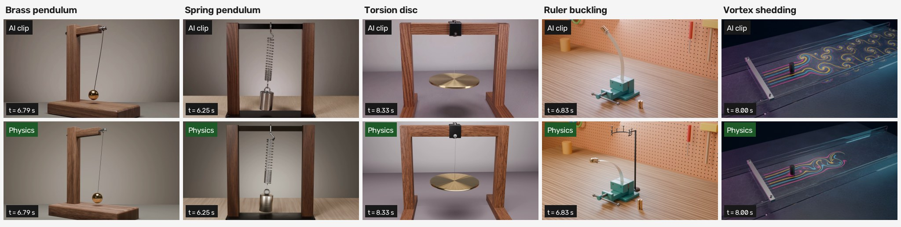

# Worked examples

The workflow was run end to end on five cases. In each one we started from an AI-generated clip, measured what it actually shows, and replaced its physics with a solved, benchmarked model rendered in the same Blender scene. An independent verifier shares no code with the solver and checks every result.

| Case | Phenomenon | Model | Solver | Key verified numbers | Status |
|---|---|---|---|---|---|
| [brass-pendulum](brass-pendulum/) | damped pendulum; the AI swing grows by 62 % | planar rigid compound pendulum, viscous pivot damping | RK4, h = 1/3072 s | order 4.000; independent solver 2e-13 rad; elliptic period 4e-14; Blender vs solver 4e-7 rad | approved by the author |
| [spring-pendulum](spring-pendulum/) | elastic pendulum; the AI shows a sideways swing instead of the requested bob | 5-DOF spring link + rocking rigid weight, Rayleigh spring mass | RK4 + exact constraint projection | order 4.00; independent solver 4e-13 m; mode frequencies 3.5e-11; energy 9e-14 | approved by the author |
| [torsion-disc](torsion-disc/) | torsion pendulum + sway; the AI sway gains energy and the camera orbits | rigid disc on inextensible wire, linear torsion, 6-DOF | RK4 + quaternion/constraint projection | order 3.99; independent GL4 4.7e-12 m; exact torsion 3e-14; P1–P10 all PASS | approved by the author |
| [ruler-buckling](ruler-buckling/) | Euler buckling of a strip under stacked weights; the AI bends it both ways and edgewise | geometrically exact planar Kirchhoff rod (discrete elastica), eccentric tip body | generalized-α, N = 268, dt 0.52 ms | P_cr 1.3576 N (independent agrees to 5e-9); n = 7 static 150.34 vs 150.32 mm; audit 7/7 | approved by the author |
| [vortex-shedding](vortex-shedding/) | Kármán vortex street at Re 150; the AI runs about 3.5× fast-forward | 2-D incompressible Navier–Stokes + floor friction, Lagrangian dye | Basilisk adaptive (0.29 mm); FEniCSx IPCS verifier | St 0.190 (independent 0.1908); Schäfer–Turek St 0.3012; audit 14/14 | complete, awaiting author approval |

Each case folder contains:

- **`README.md`**: what the AI clip got wrong, the corrected physics with provenance labels, verification numbers, declared deviations, and reproduce commands.
- **`CONTRACT.md`**, **`config/`** (acceptance tolerances, CHANGELOG, camera, prompt), **`params/physics.json`**, **`physics/FORMULATION.md`**: the inputs and declarations.
- **`solver/`**, **`scene/`**, **`verify/`**, **`measurement/`** (and `camera/` for the first three cases): source code. Run outputs, renders, `.blend` files and caches are not included.
- **`evidence/`**: the verifier and audit JSON results and the original case report that the numbers come from.
- **`media/`**: downscaled stills and plots. `media/videos.json` links the full videos on fal storage, with sha256 hashes.

None of the cases claims real-world accuracy. The AI clips are generated footage, not measurements. What each case shows is that the rendered scene does exactly what a declared, benchmarked physics model says, and where the AI clip departs from that model.
