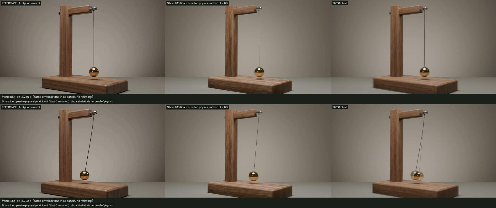
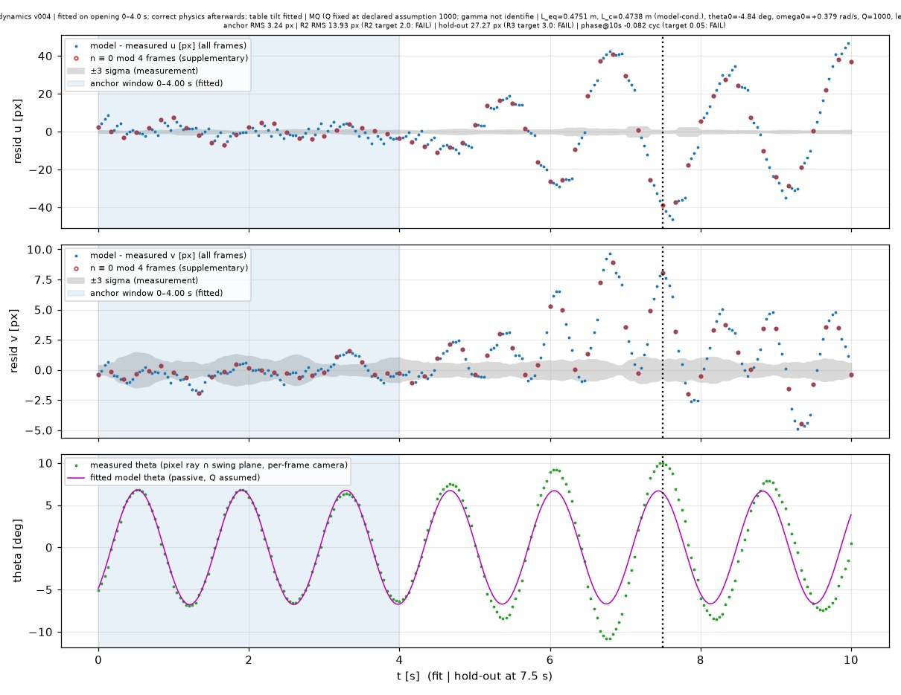
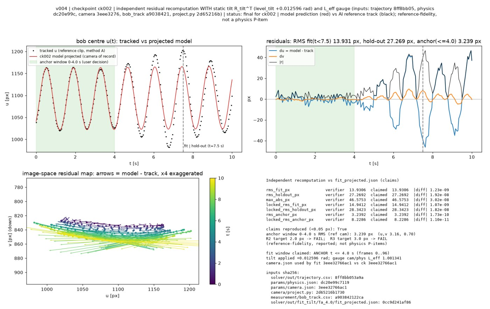
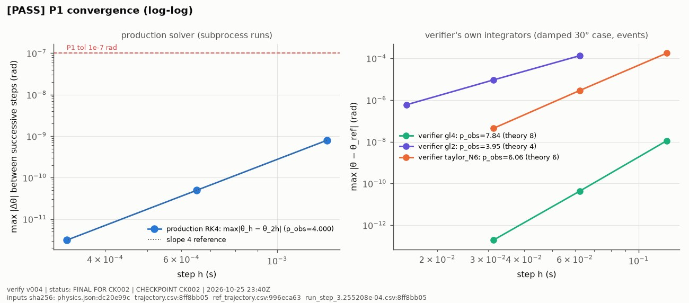
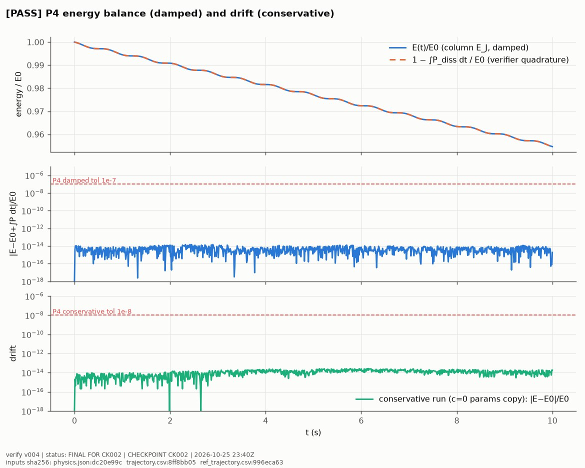

# Brass pendulum

A brass bob swings on a wire from a walnut stand. The AI clip's swing grows and its period drifts. Here that motion is replaced with a solved, verified, damped compound pendulum, rendered in the same scene.



| Video | Link |
|---|---|
| Reconstruction (1920×1088, 10 s, 24 fps) | [v004_reconstruction_ck003_1920x1088.mp4](https://v3b.fal.media/files/b/0aaff792/KvfaQqpImbD8ArgPS3bil_v004_reconstruction_ck003_1920x1088.mp4) |
| Side-by-side: AI clip / physics / 50-50 blend | [v004_sbs_ck003_final_f000-240.mp4](https://v3b.fal.media/files/b/0aaff792/5mLxPMLYaKqfNXoHIQw77_v004_sbs_ck003_final_f000-240.mp4) |

Sizes and sha256 hashes are in [`media/videos.json`](media/videos.json). The AI clip came from the text-to-video request in [`config/prompt.json`](config/prompt.json).

## What the AI clip got wrong (measured)

- After 4 s the swing amplitude **grows by 62 %** and the period wanders between 1.36 and 1.43 s. A passive pendulum cannot do this.
- The camera pushes in by 3.3 %, even though the prompt asked for a locked-off camera.
- The wire is drawn bowed, and the apparent rotation point sits 8 % below the visible hinge.
- Every 4th frame jumps (a generator cadence defect).

None of these defects were copied into the physics. The camera push-in is reproduced as camera motion, because it is part of the shot rather than part of the physics.

## Corrected physics

The model is a planar rigid compound pendulum: a solid brass sphere on a rigid, massless wire. The hinge is where the wire leaves the loop. Damping is linear and viscous at the pivot. The equations were solved offline with RK4 (h = 1/3072 s) and baked as 241 keys. See [`physics/FORMULATION.md`](physics/FORMULATION.md) and [`solver/NOTES.md`](solver/NOTES.md).

The parameters were fitted on the opening window t ∈ [0, 4.0] s. The window rule was fixed before fitting: it ends at the first amplitude jump larger than 3σ.

| Parameter | Value | Provenance |
|---|---|---|
| L_eq (equivalent length) | 0.4751 ± 0.0026 m | model-conditioned (period + assumed g) |
| L_c (hinge → bob centre) | 0.4739 m | model-conditioned |
| bob radius r | 38.5 mm (L_c/r = 12.30) | measured ratio, model-conditioned scale |
| period | 1.3842 s | fitted |
| θ(0), ω(0) | −4.84°, +0.379 rad/s | fitted |
| static scene tilt vs gravity | +0.722° ± 0.057° | fitted (unlevel-table hypothesis) |
| Q (damping) | 1000 (plausible range 300–6000) | **assumed**; cannot be identified from the clip |
| mass | 2.0 kg (brass 8500 kg/m³) | assumed; the dynamics do not depend on mass |
| g | 9.80665 m/s² | assumed |

## Verification

The independent verifier ([`verify/`](verify/)) shares no code with the solver. Tolerances were declared in advance in [`config/acceptance.json`](config/acceptance.json), and every check was run on the saved checkpoint files. Results are in [`evidence/`](evidence/).

| Check | Result |
|---|---|
| P1 convergence order | 4.000 (finest difference 3e-12 rad) |
| P2 independent Taylor / Gauss–Legendre solver | agrees to 2e-13 rad |
| P3 exact elliptic period | 4e-14 relative |
| P4 energy balance | 1.5e-14 E0, no growth |
| P5 pivot fixed, length, planarity | \|L − L_c\| 4e-8 m |
| P6 Blender-evaluated motion vs solver | 4e-7 rad (4 subframes per frame) |
| P7 wire tension | 19.8–20.2 N |
| P9 controls (L×4, 2°, 15°, damping×10) | behave as the formulas predict (1e-8) |
| P10 clean rebuilds | motion and geometry bitwise identical |
| Tilt audit | PASS |

These checks show that the scene does exactly what the declared model says. They do not show what a real pendulum would do.

### Fit residuals and divergence from the AI clip






## Results vs the reference (the AI clip is not ground truth)

| Quantity | Target | Result |
|---|---|---|
| Opening window 0–4 s, projected bob vs tracked bob | — | 3.24 px RMS (tracking σ ≈ 0.3 px) |
| R2: 0–7.5 s | 2 px | 13.9 px, **FAIL**: the AI swing grows and its period wanders |
| R3: 7.5–10 s | 3 px | 27.3 px, **FAIL**, same cause |
| After 4 s | — | diverges from the AI clip by up to ~45 px (this is the wrong physics made visible) |
| Render vs solver projection (visual review) | — | 0.07 px; silhouette IoU 0.94 |

## Declared deviations

- R2 and R3 fail as declared, and the failure is attributed to the defects in the AI clip. The tolerances were not changed ([`config/CHANGELOG.md`](config/CHANGELOG.md)).
- Damping is not visible in the image: the push-in masks a 2 % decay. Q is an assumption.
- The wire is about 1.5× thinner than the AI draws it.
- The render is slightly brighter than the reference on the wood, table and bob. The author froze the look at this setting.

## Reproduce

All commands run from this folder. You need Blender 5.2+ (`build_all.sh` expects `blender` (or `$BLENDER`); edit `B=` otherwise) and a Python venv at `.venv` with numpy, scipy, opencv-python and matplotlib.

```sh
python3 -m venv .venv && .venv/bin/pip install numpy scipy opencv-python matplotlib
.venv/bin/python solver/run.py          # trajectory from params/physics.json -> solver/out/trajectory.csv
.venv/bin/python solver/selfcheck.py
./build_all.sh ck_local                 # build + bake the scene, rig/camera checks, freeze checkpoints/ck_local
```

- The verifier commands are in [`verify/PLAN.md`](verify/PLAN.md) and [`verify/clean_rebuild_verifier.sh`](verify/clean_rebuild_verifier.sh).
- Measurement and camera calibration code is in `measurement/` and `camera/`. It needs the AI reference clip, which is not included.
- The scene uses the vendored node kit in `scene/vendor/` (from video-to-blender).

Status: **approved by the author.**
