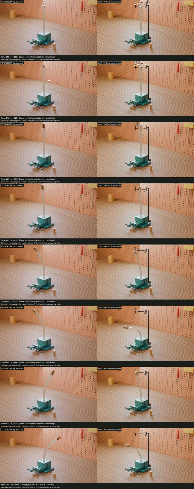
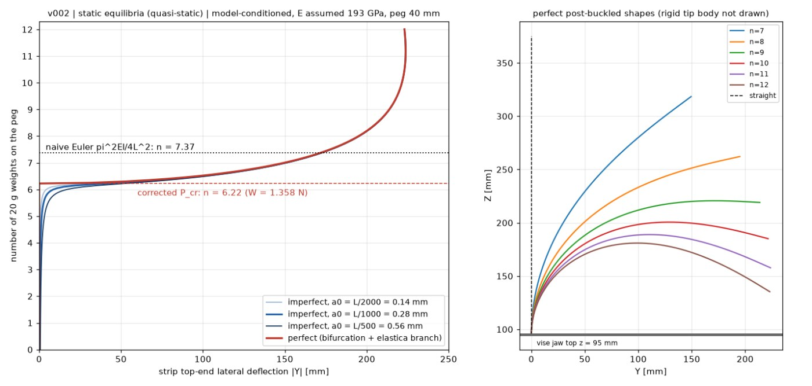
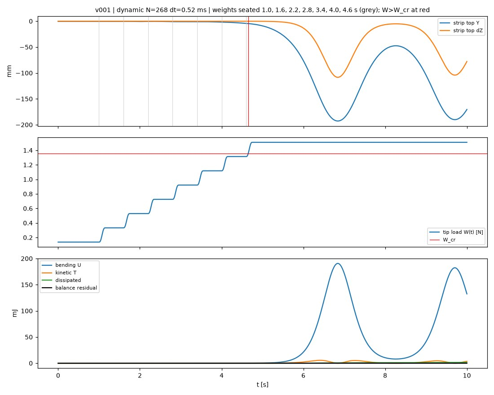
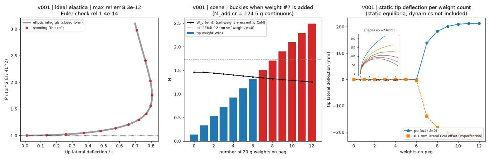
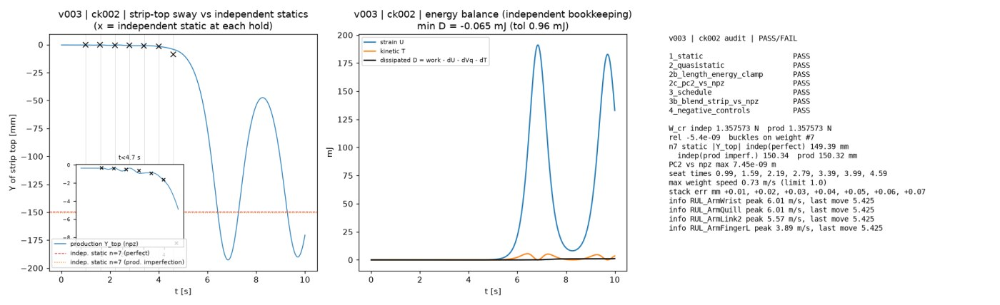

# Ruler buckling (elastica)

A thin steel strip is clamped upright in a vise, and brass weights are stacked on a platform at its top until it buckles. In the AI clip, weights appear in mid-air and the strip bends both ways under a constant load. Here it is replaced with a geometrically exact rod solution, checked by an independent elastica verifier.



| Video | Link |
|---|---|
| Reconstruction (1920×1088, 10 s, 24 fps) | [final_ck002_1920x1088.mp4](https://v3b.fal.media/files/b/0aaff793/URFZU7ItJ7ntuy-_ql84Y_final_ck002_1920x1088.mp4) |
| Side-by-side: AI clip / physics | [ck002_sbs.mp4](https://v3b.fal.media/files/b/0aaff793/5inSNa0rtNA8ZzBomv91__ck002_sbs.mp4) |
| AI reference clip (image-to-video from our first frame) | [reference.mp4](https://v3b.fal.media/files/b/0aaff793/v6jgKggwsoxK2USHdd3xf_reference.mp4) |

Sizes and sha256 hashes are in [`media/videos.json`](media/videos.json). We built the first frame in Blender ([`media/first_frame.jpg`](media/first_frame.jpg)) and gave it to an image-to-video generator with the prompt in [`config/prompt.json`](config/prompt.json). The reference clip is that generator's output.

## What the AI clip got wrong (measured, `measurement/summary.json`)

- Weights **appear mid-air**, with no hand. The count jumps two at a time (1 → 3 → 5 → 7), and the bench stack never shrinks.
- The strip leans toward camera-left from about 5.0 s (onset rule 5.25 s, 7 weights) and plateaus near −77 mm. Then it **swings back through vertical and over to the right (+171 mm) under a constant load**.
- After about 7.7 s the bending is mostly **edgewise** (about the strong axis), which a 25 × 0.5 mm strip cannot do.
- The camera is static (≤ 1.5 px).

None of these behaviours were imitated.

## Corrected physics

The model is a geometrically exact planar Kirchhoff rod: an inextensible discrete elastica with N = 268, self-weight and a rigid eccentric tip body. Time stepping uses generalized-α (ρ∞ 0.85) with dt 0.52 ms. **Nothing is fitted to the reference.** See [`physics/FORMULATION.md`](physics/FORMULATION.md) and [`physics/benchmarks.json`](physics/benchmarks.json).

| Quantity | Value | Provenance |
|---|---|---|
| strip | 300 × 25 × 0.5 mm; 0.268 m free above the jaw; top 12 mm stiffened by tabs | measured / declared from our own first frame |
| weights | 20 g slotted brass at 4.5 mm pitch | declared from our own first frame |
| tip body | 13.94 g (plate + 40 mm peg) | declared from our own first frame |
| E | 193 GPa (spring-temper 301 stainless) | **assumed** (literature) |
| g | 9.81 m/s² | assumed |
| damping | Q ≈ 50 (Rayleigh α 0.063 s⁻¹, β 3.2e-4 s, + quadratic air drag) | **assumed** |
| imperfection | L/1000 toward −Y | assumed |
| loading schedule | 7 weights seated at 1.0 + 0.6 j s, 0.15 s contact ramp | scene design, fixed before solving |

**Result.** The critical load is **1.3576 N**, so the strip becomes supercritical while the 7th weight is seated (4.66 s).

- It topples slowly: 10 mm at 5.05 s and 50 mm at 5.79 s.
- It overshoots to −193 mm at 6.8 s.
- It then sways, damped, about the n = 7 equilibrium (−150.3 mm, 53.9°) at about 0.35 Hz. The sway always stays on the same side and always bends about the weak axis.
- The maximum tip rotation is 75.4°, below 90°, so the weights stay pressed on the plate.
- The root stress at the n = 7 static state is 252 MPa, which is elastic for spring temper.




## Verification

**Solver self-checks:**

| Check | Result |
|---|---|
| Euler P_cr error (order) | 2.6e-6 (2.00) |
| Eccentric-load closed form | 7.7e-5 |
| Elastica 90° tip angle, P/P_cr | 1.39324 vs 1.39320 |
| Static n = 6 / 7 / 10 vs benchmarks | within 0.03 mm |
| Dynamic mesh convergence (N 134 vs 268) / time step | 0.30 mm / 1.2 µm |
| Energy balance residual | 1.9e-4 of peak strain energy |

**Independent verifier.** It uses its own shooting-method elastica code and imports nothing from the solver ([`verify/ref/`](verify/ref/), [`verify/checks/`](verify/checks/)). Results are in [`evidence/`](evidence/).

| Check | Result |
|---|---|
| W_cr / n_cr | 1.3575726 N / 6.2224 (agrees to 5e-9) |
| n = 7 static deflection | 150.339 vs 150.316 mm |
| Quasi-static holds, n = 0–5 | within 0.27 mm |
| Length preservation | ≤ 3.2e-7 m |
| Blender-evaluated mesh vs solver | 7.5e-9 m at all 1201 samples |
| Negative controls | 6/6 caught |
| ck002 audit | **7/7 PASS** |

The ck002 audit covers the weight transfers: peak speed 0.68–0.73 m/s, each weight seated within 0.1 mm of its slot, never more than 7 on the peg, and no visibility toggles. In ck001 the weights had teleported at about 14 m/s.




## Scene and look

The scene matches our first frame, not the generator's softer grade. Frame-0 mean difference against our frame0 is 3.3 for our render and 9.7 for the reference (8-bit).

**Our additions, not in the reference:**
- a 40 mm peg on the platform;
- a ring feeder at the ruler top that holds the 7 weights;
- an overhead pick-and-place arm that carries each weight about 6 cm at ≤ 0.73 m/s and leaves the frame by 5.42 s.

Scene checks over every frame plus the contact subframes found 0 intersections and strip-at-jaw error 4.8e-7 m. Rebuilds are bit-identical.

## Declared deviations and sensitive assumption

- The sway amplitude after buckling depends on the assumed damping, and so does the pose at 10 s (−170 mm). An undamped run differs by up to 182 mm. The buckling load, the onset weight and the static bent shape do not depend on damping.
- The post-buckled frames never settle (Q ≈ 50). The ≤ 1 % post-buckling check therefore rests on the static n = 7 cross-check rather than on the dynamic frames.
- The empty gripper peaks at 3.2 m/s on its return between pedestals (2–3 frames). The arm links and quill reach up to 6 m/s on empty returns, mostly above the frame.

## Reproduce

All commands run from this folder with a Python that has numpy, scipy and matplotlib, plus Blender 5.2+.

```sh
python physics/derive.py                      # benchmarks.json + load-deflection plot
cd solver && python static_study.py           # linear buckling, elastica, actual path, imperfections (~6 s)
python dynamic.py 67 960; python dynamic.py 134 960; python dynamic.py 268 960     # mesh levels (dt 1.04 ms)
python dynamic.py 268 480; python dynamic.py 268 1920                             # time-step levels (2.08 / 0.52 ms)
python dynamic.py 268 960 1.0 N268_dt960_nodamp_rho1                              # undamped energy check
python post.py && cd ..                       # deformation.npz on the scene grid + meta.json + visuals
python verify/ref/validate_reference.py       # independent elastica reference
python verify/checks/check_production.py      # production checks on solver/out/deformation.npz
python verify/checks/negative_controls.py
blender -b --factory-startup --python scene/build_anim.py -- --out ruler_anim.blend --deformation solver/out/deformation.npz
```

`build_all.sh` runs the Blender step under the skill's render lock (`v2p.py lock --`). The exact run tags and the order of runs are recorded in [`config/CHANGELOG.md`](config/CHANGELOG.md).

Status: **approved by the author.**
