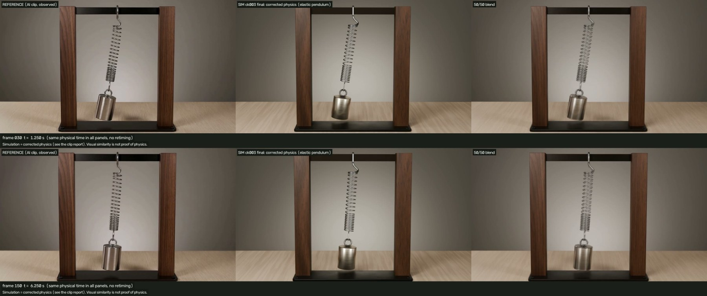
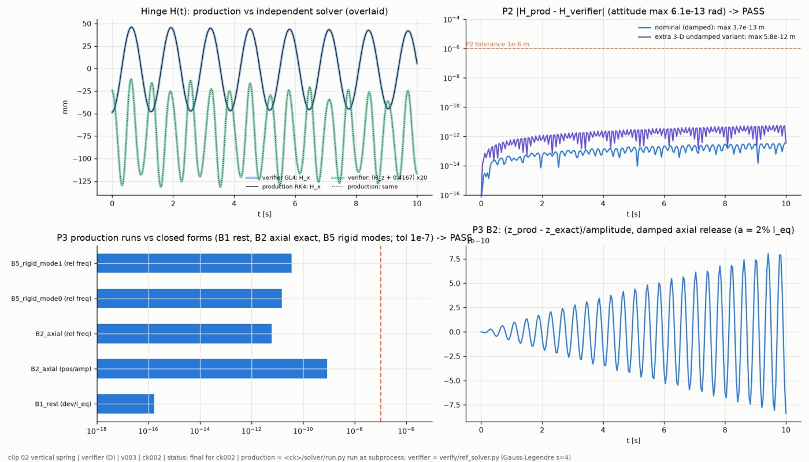
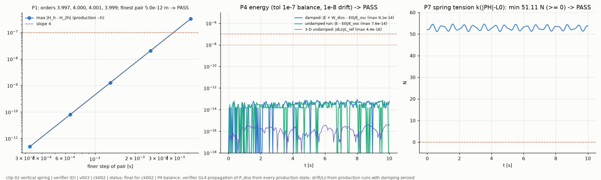
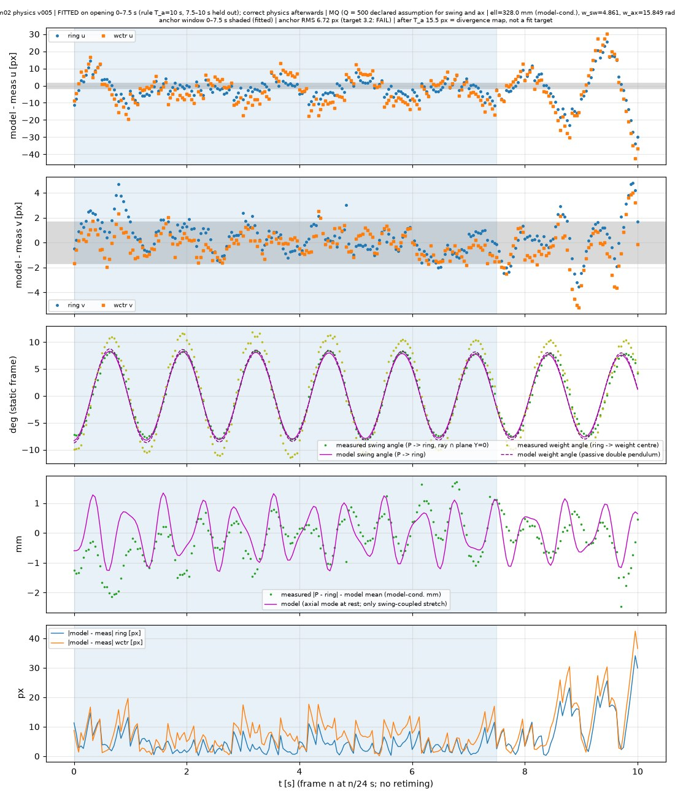
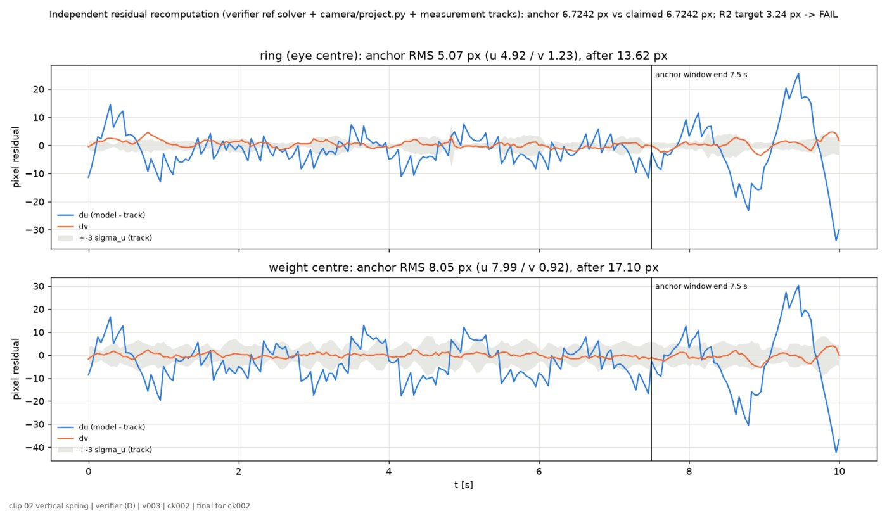

# Spring pendulum (elastic pendulum)

The prompt asked for a weight bobbing vertically on a spring. The AI clip shows a sideways swing whose amplitude and period drift instead. That swing is a real elastic pendulum, so the general physical system was solved and verified here. The motion was not forced to match the clip.



| Video | Link |
|---|---|
| Reconstruction (1920×1088, 10 s, 24 fps) | [v003_reconstruction_ck003_1920x1088.mp4](https://v3b.fal.media/files/b/0aaff792/BE3PJk6Nkn6HCv710XAV3_v003_reconstruction_ck003_1920x1088.mp4) |
| Side-by-side: AI clip / physics / 50-50 blend | [v003_sbs_ck003_final_f000-240.mp4](https://v3b.fal.media/files/b/0aaff792/h2R2nWH8HM2oWAnRR5EXg_v003_sbs_ck003_final_f000-240.mp4) |

Sizes and sha256 hashes are in [`media/videos.json`](media/videos.json). The generator request is in [`config/prompt.json`](config/prompt.json).

## What the AI clip got wrong (measured)

- There is **no vertical bob**, although the prompt asked for about 1 cm. Instead the weight swings sideways ±8° with a period of 1.30 s.
- The weight over-tilts to 1.34× the swing angle.
- The swing amplitude wanders (+4.5 %, then −7.5 %) and the half-period drifts by +7.5 %. A passive spring–mass system does neither.
- The camera zooms by +4.8 %.
- Every 4th frame jumps (a generator cadence defect).

## Corrected physics

The model is a 5-DOF elastic pendulum ([`physics/FORMULATION.md`](physics/FORMULATION.md), [`solver/NOTES.md`](solver/NOTES.md)):

- An elastic spring link runs from the swing hinge P_eff to the weight's eye H. P_eff is the top coil, below the fixed S-hook, because a hook on a bar cannot rotate along the bar.
- A rigid steel cylinder is hinged at H, so it can rock.
- Spring mass is included with the Rayleigh approximation, and damping is linear.
- The solver is RK4 with exact constraint projection. It has guards for spring compression and constraint drift, and the motion is baked at 4 keys per frame (the rocking mode is 26 rad/s).

The fit window was 0–7.5 s under the predeclared window rule (the last 2.5 s are held out). A diagnostic fit on 0–4 s is also reported.

| Parameter | Value | Provenance |
|---|---|---|
| ℓ (spring link length) | 0.3280 ± 0.0009 m | model-conditioned (swing period + assumed g) |
| scale | 0.4166 m per crossbar span | model-conditioned |
| φ0 | −8.3° | fitted |
| k | 1336 N/m | **assumed**: the clip shows no bob, so k cannot be measured |
| mass | 5.2 kg | **assumed**; cannot be identified |
| Q (damping) | 500 | **assumed**; cannot be identified |
| g | 9.80665 m/s² | assumed |

The axial mode starts at rest. Coupling predicts only ±2 mm of stretch.

## Verification

The independent verifier ([`verify/`](verify/)) was run on ck002. The motion in ck003 is bitwise identical. Results are in [`evidence/`](evidence/).

| Check | Result |
|---|---|
| P1 convergence order | 4.00 |
| P2 independent Gauss–Legendre solver | 4e-13 m |
| P3 exact static, axial and two swing-mode frequencies | 3.5e-11 |
| P4 energy balance / vertical angular momentum | 9e-14 / 4e-16 |
| P5 spring attached at both ends, 21 turns constant, anchor fixed | PASS |
| P6 Blender vs solver | 1.5e-8 m / 3e-8 rad |
| P7 tension | ≥ 51 N |
| P9 controls (k×4, m×4, L0+50 %, damping×10) | match the formulas (≤ 4e-6) |
| P10 clean rebuilds | bitwise identical |

P9 failed on ck001: the solver let |n| drift until the result became NaN. It was fixed with constraint projection and re-equilibrated variant starts.






## Results vs the reference (the AI clip is not ground truth)

| Quantity | Target | Result |
|---|---|---|
| Fitted window 0–7.5 s RMS | 3.24 px | 6.72 px, **FAIL**: the AI clip's period wander and excess weight tilt |
| After 7.5 s | — | 15.5 px |
| Render vs simulation (independent visual review) | — | 0.1 px |

## Declared deviations

- The prompt asked for a vertical bob, but we model the swing the clip actually shows, as a real elastic pendulum.
- The fit-window RMS fails its target. The failure is attributed to defects in the AI clip; the tolerance was not changed.
- Known residuals: the weight's highlight bands are about 0.1 L weaker than the reference, the right half of the crossbar is +0.10 L, and the tight-coil pitch is slightly larger. The AI draws the coils as flat rings, while ours are true helices.

## Reproduce

All commands run from this folder. You need Blender 5.2+ (`blender` (or `$BLENDER`) in `build_all.sh`) and `.venv` with numpy, scipy, opencv-python and matplotlib.

```sh
python3 -m venv .venv && .venv/bin/pip install numpy scipy opencv-python matplotlib
.venv/bin/python solver/run.py
.venv/bin/python solver/selfcheck.py
./build_all.sh ck_local
```

The verifier commands are in [`verify/PLAN.md`](verify/PLAN.md) and [`verify/clean_rebuild_verifier.sh`](verify/clean_rebuild_verifier.sh). The coordinate conventions are in [`config/coordinates.md`](config/coordinates.md).

Status: **approved by the author.**
