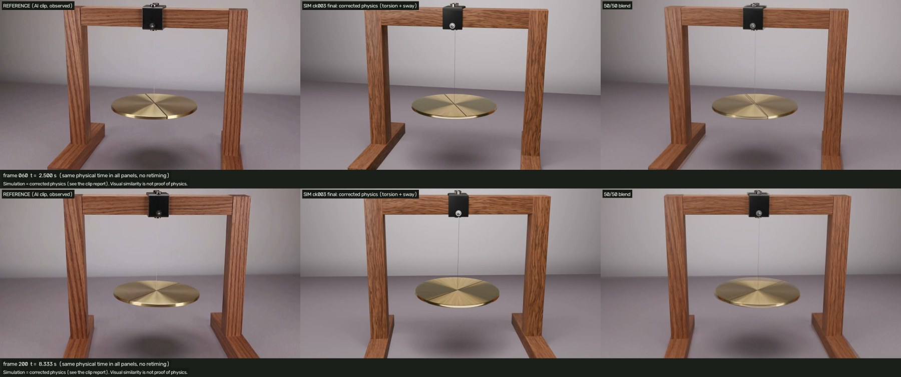
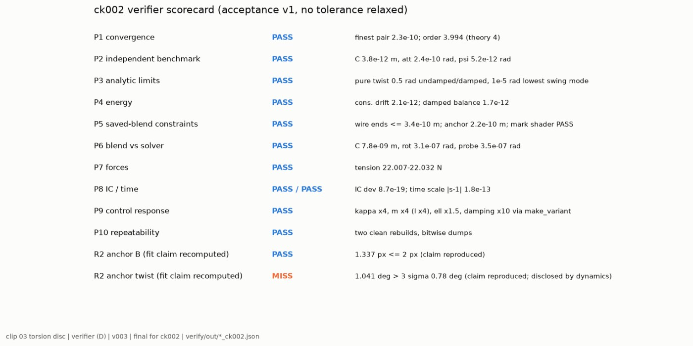
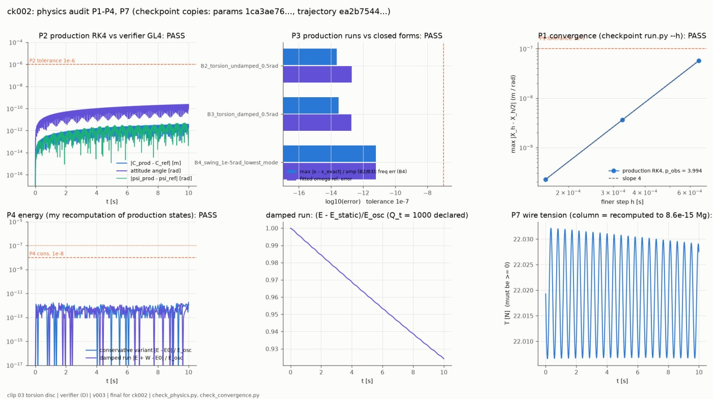
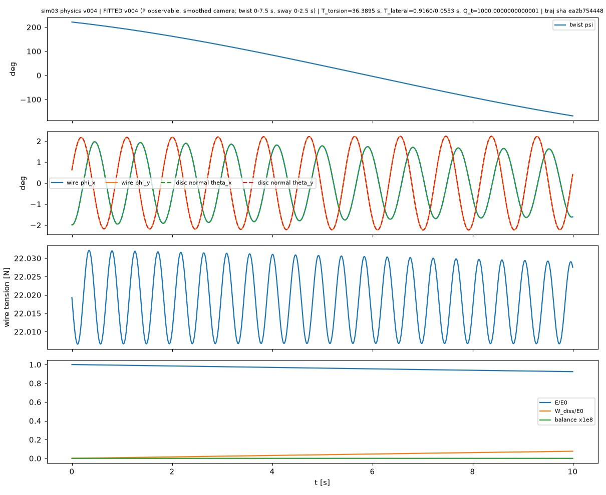
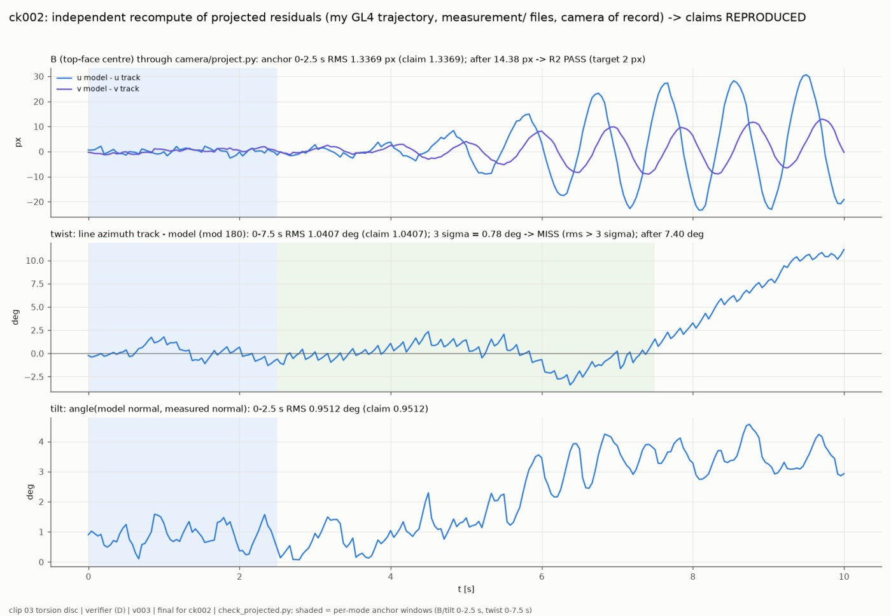

# Torsion disc

A brass disc hangs on a steel wire. The AI clip turns it one way by −379°; physically that is the middle of one slow torsion half-swing, so the twist itself is plausible. The sway, the tilt, the drawn mark and the camera are wrong. They are replaced here with a solved, verified rigid-disc-on-wire model.



| Video | Link |
|---|---|
| Reconstruction (1920×1088, 10 s, 24 fps) | [v003_reconstruction_ck003_1920x1088.mp4](https://v3b.fal.media/files/b/0aaff793/75HGVTbcgK6k4vNys2X9O_v003_reconstruction_ck003_1920x1088.mp4) |
| Side-by-side: AI clip / physics / 50-50 blend | [v003_sbs_ck003_final_f000-240.mp4](https://v3b.fal.media/files/b/0aaff793/7cs5kwcM4OUL1DkOFL4dW_v003_sbs_ck003_final_f000-240.mp4) |

Sizes and sha256 hashes are in [`media/videos.json`](media/videos.json). The generator request is in [`config/prompt.json`](config/prompt.json).

## What the AI clip got wrong (measured)

The prompt asked for a few degrees of back-and-forth twist. The clip turns **−379° in 10 s**. The rate goes −25 → −47 → −33 °/s, which matches the middle of one torsion half-swing (period ~36 s). The parts that are not physical:

- The small sway is a disc-and-wire pendulum with a 0.95 s period, and it **gains energy twice**: +50 % at 0.65 s and +45 % at 3–5 s.
- After 7.5 s the twist slows faster than physics allows.
- The engraved line is drawn as a full diameter. Its apparent rotation centre stays fixed in the room instead of on the disc.
- The disc tilts only 0.64× the physical amount in one axis.
- The camera **orbits 23°** around the stand, although the prompt asked for a locked-off camera.
- Every 4th frame jumps (a generator cadence defect).

## Corrected physics

The model is `disc_on_wire_rigid6_v1` ([`physics/FORMULATION.md`](physics/FORMULATION.md), [`solver/NOTES.md`](solver/NOTES.md)):

- A rigid brass disc hangs on an inextensible steel wire, with linear torsion and compound-pendulum sway and tilt.
- The disc–wire joint is rigid, modelled as a stiff joint spring.
- The solver is RK4 with exact quaternion and constraint projection. It has guards for a slack wire, constraint drift and non-finite values, and the motion is baked at 4 keys per frame.

| Parameter | Value | Provenance |
|---|---|---|
| disc diameter | 22.1 cm | model-conditioned (sway period, assumed g) |
| wire length | 0.191 m | model-conditioned |
| κ/I | from the 36.4 s torsion period | fitted |
| pivot offset from the assumed clamp point | (3.2, −6.4) mm | fitted |
| wire material | hard-drawn music wire (needed for elastic twist at 221°) | **assumed**, declared |
| Q_t (torsion) / Q (sway, tilt) | 1000 / 500 | **assumed**; cannot be identified |
| g | 9.80665 m/s² | assumed |

**Declared deviation.** The modes were fitted separately instead of in the single declared window: twist on 0–7.5 s, and sway/tilt on 0–2.5 s. This is justified because the modes are decoupled; sway changes the twist by at most 0.14° over 10 s. The observable is the centre of the disc silhouette, seen through the smoothed camera of record.

## Verification

The independent verifier ([`verify/`](verify/)) was run on ck002; ck003 changes only the look. Results are in [`evidence/`](evidence/). All checks passed. This was the first case to pass P1–P10 on its first audit.

| Check | Result |
|---|---|
| P1 convergence order | 3.99 |
| P2 independent GL4 solver | 4.7e-12 m / 2.4e-10 rad |
| P3 exact torsion (undamped/damped) / swing mode | 3e-14 / 6e-12 |
| P4 energy drift / damped balance | 2.1e-12 / 1.7e-12 |
| P5 pivot, wire ends, rigid mark | wire ends ≤ 3.4e-10 m |
| P6 Blender vs solver | 7.8e-9 m / 3.1e-7 rad |
| P7 tension | 22.0 N |
| P9 controls (κ×4, m×4, ℓ×1.5, damping×10) | match the formulas |
| P10 clean rebuilds | bitwise identical |






## Results vs the reference (the AI clip is not ground truth)

| Quantity | Target | Result |
|---|---|---|
| Disc centre, fit window | 2.2 px | 1.34 px, PASS |
| Twist, fit window | 0.78° | 1.04°, **FAIL**: ≈1 Hz wobble of the AI's drawn mark |
| Disc centre after the windows | — | 14.4 px (the AI clip injects sway energy) |
| Twist at 10 s | — | up to −11° (the AI clip slows too fast) |
| Render vs simulation | — | twist 0.07°, centre ≤ 0.8 px |

## Declared deviations

- The fits are per mode (see above).
- The twist-window target fails, and the failure is attributed to the wobble of the AI's drawn mark.
- The reference wire leaves the clamp about 6 px left of ours. Our collet mesh stays at the visible clamp, and the pivot was fitted inside it.
- The camera orbit is reproduced from the clip's measured camera path, smoothed: the static-scene jerk went from 3.6 to 0.18 px.

## Reproduce

All commands run from this folder. You need Blender 5.2+ (`blender` (or `$BLENDER`) in `build_all.sh`) and `.venv` with numpy, scipy, opencv-python and matplotlib.

```sh
python3 -m venv .venv && .venv/bin/pip install numpy scipy opencv-python matplotlib
.venv/bin/python solver/run.py
.venv/bin/python solver/selfcheck.py
./build_all.sh ck_local
```

Verifier commands are in [`verify/PLAN.md`](verify/PLAN.md). Examples (with `CK` = checkpoint dir):

```sh
.venv/bin/python verify/ref_solver.py --params $CK/params/physics.json --out ref.csv --lyapunov
.venv/bin/python verify/check_physics.py --params $CK/params/physics.json --trajectory $CK/solver/out/trajectory.csv --ref ref.csv ...
```

Status: **approved by the author.**
