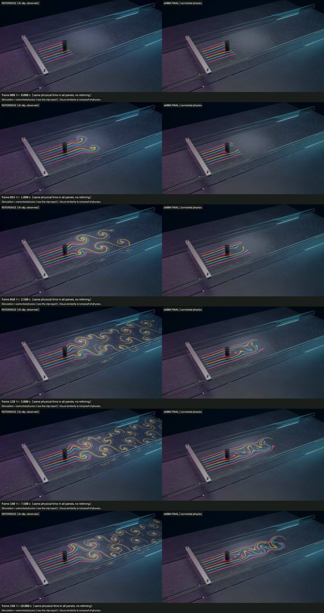
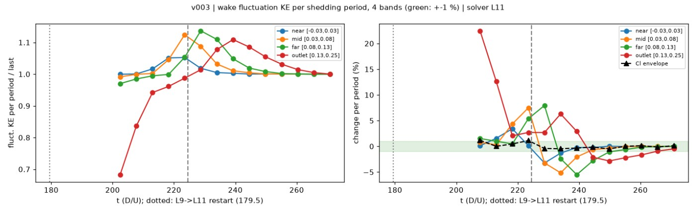
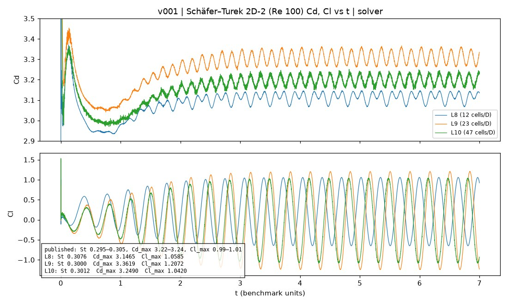
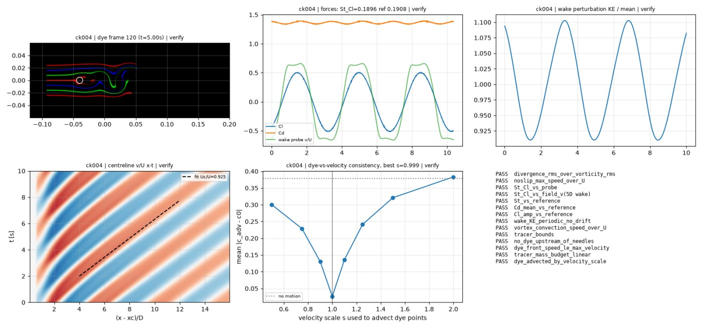
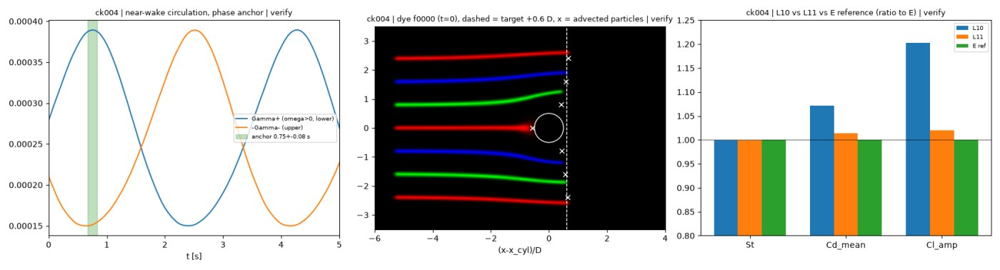

# Vortex shedding (Kármán street, dye)

Coloured dye flows past a cylinder in a shallow water channel. The AI clip runs about 3.5× fast-forward, and its vortex street is too wide. Here it is replaced with a 2-D incompressible Navier–Stokes solution at Re = 150, with the dye drawn as material lines advected by the solver's velocity field. An independent FEniCSx solver verifies the result.



| Video | Link |
|---|---|
| Reconstruction (1920×1088, 10 s, 24 fps) | [final_ck004_1920x1088.mp4](https://v3b.fal.media/files/b/0aaff794/mtpIr-BFQRUpsZ-tsPBVS_final_ck004_1920x1088.mp4) |
| Side-by-side: AI clip / physics | [ck004_sbs.mp4](https://v3b.fal.media/files/b/0aaff794/9bHQMmRi-i6lZvNbE2u7B_ck004_sbs.mp4) |
| AI reference clip (image-to-video from our first frame) | [reference.mp4](https://v3b.fal.media/files/b/0aaff794/NYhxI2WhNSYJxPK6F4BoE_reference.mp4) |

Sizes and sha256 hashes are in [`media/videos.json`](media/videos.json). We built the first frame in Blender ([`media/first_frame.jpg`](media/first_frame.jpg)), and the generator prompt is in [`config/prompt.json`](config/prompt.json).

## What the AI clip got wrong (measured, `measurement/summary.json`)

The clip runs about **3.5× fast-forward**:

- The dye front advances at 3.9 U, against a physical maximum of about 1.5 U, and leaves the view at 4.9 s.
- Shedding is at 0.89 Hz; physics gives 0.28 Hz.
- Vortices move at 3.2 U (physics: ≈ 0.85–0.9 U), and they speed up downstream.

Other defects:

- The vortex rows are 4.7 D apart; physics gives ≈ 1–2 D. As a result, dye from the outer needles is rolled into the street.
- The start looks impulsive.
- The colour mix is not conserved: magenta drops from 46 % to 5 %.
- The period wanders by 13 %.
- The camera drifts by up to 5.9 px.

The vortex spacing (~5.5 cm) is roughly physical. None of these behaviours were imitated.

## Corrected physics

See [`physics/FORMULATION.md`](physics/FORMULATION.md) and [`physics/benchmarks.json`](physics/benchmarks.json). The solver source is in [`solver/src/`](solver/src/).

| Quantity | Value | Provenance |
|---|---|---|
| ν (water) | 1.0e-6 m²/s | declared |
| U (mid-depth centreline at the cylinder, empty channel) | 0.015 m/s → Re = 150 | declared |
| D, channel, depth | 10 mm; 0.6 × 0.12 m; 20 mm | declared from our first-frame geometry |
| plug inflow U_in | 0.013874 m/s | calibrated by an empty-channel run |
| floor friction λ (−λu) | λ = (π²/4)ν/h² = 6.17e-3 1/s (shallow-wake number 0.0056: the street is not suppressed) | model (derived from declared ν, h) |
| D_m (dye) | 1e-9 m²/s | assumed |
| shedding phase | lower side (ω > 0) rolls up first at 0.756 s (AI: 0.75 s) | the only reference-anchored choice |

- **Model.** 2-D incompressible Navier–Stokes in the dye plane, solved with Basilisk. The cylinder is embedded in an adaptive grid with 0.29 mm cells. The walls are no-slip and the outflow is zero-gradient.
- **Limits.** There are no 3-D floor or surface end effects (h/D = 2). These may lower St by a few percent; this was not quantified.
- **State.** The 10 s window is cut from a settled periodic run: wake kinetic energy changes by less than 1 % per period in all bands. Shedding at Re 150 needs far more than 10 s to start.
- **Dye.** Real dye barely diffuses (Sc ≈ 1000), so the streaks are material lines. They are advected through the solver's velocity history from the needle sources (RK4, 1/48 s). They are drawn as mass-conserving filaments that thin and fade as the flow stretches them: σ² = σ0²/λ² + 2·D_m·age. The dye is released at −3.875 s.
- **Result.** St 0.190 (0.284 Hz, 2.8 periods in 10 s), mean Cd 1.365, Cl′ 0.506.



## Verification

**Solver benchmark: Schäfer–Turek 2D-2 at 46 cells/D.**

| Quantity | Result | Published band |
|---|---|---|
| St | 0.3012 | 0.295–0.305 |
| Cd_max | 3.249 | +0.3 % over band |
| Cl_max | 1.042 | +3 % over band |
| Production St, L10 vs L11 | converged within 0.3 % | — |



**Independent verifier.** It uses FEniCSx IPCS with Taylor–Hood elements and shares no code with the solver ([`verify/ref/ipcs_cylinder.py`](verify/ref/ipcs_cylinder.py)).

- Schäfer–Turek: St 0.302, Cd_max → 3.240 (extrapolated).
- Production geometry: St 0.1908, Cd 1.368, Cl′ 0.499.
- Negative controls: 5/5 caught.

**ck004 audit: 14/14 PASS** ([`evidence/ck004_audit.json`](evidence/ck004_audit.json), [`evidence/checks_ck004.json`](evidence/checks_ck004.json)).

| Check | Result |
|---|---|
| St / Cd / Cl′ vs independent | 0.1896 (−0.6 %) / 1.364 (−0.3 %) / 0.508 (+1.7 %) |
| Divergence | 1.2 % |
| Wake KE | −0.11 %/period |
| Vortex convection | 0.925 U |
| Dye advected by the solver velocity (scale) | 0.999 |
| Tracer mass budget | 0.8 % |
| Dye front at t = 0 | +0.57…0.67 D |
| Phase | 0.756 s, lower side first |
| Blender wiring | PASS |




## Scene and look

The camera is the exact frame-0 camera. The dye frames are mapped onto the dye sheet through Snell refraction at the water surface (≤ 0.14 px). The cylinder, needles and walls occlude the dye, and film grain is applied per frame. Rebuilds are reproducible: the state file is byte-identical.

## Declared deviations

- **Frame 0.** Our first frame showed a magenta ring around the cylinder base. It was drawn by the potential-flow look model used for frame 0, which wraps dye around the cylinder instantly. In the solved flow, dye arriving at the stagnation point needs about 1–2 s to wrap the cylinder, so the ring forms early in the clip rather than being present at t = 0.
- The flow is a 2-D model of a shallow channel. The fluid values are declared, not measured. This is not a claim of real-world accuracy.

## Reproduce

You need Basilisk (`qcc`), Python with numpy, scipy and matplotlib, and Blender 5.2+. The verifier also needs FEniCSx (dolfinx 0.11) and gmsh.

```sh
cd solver
BASILISK=/path/to/basilisk/src PY=python3 ./src/reproduce.sh   # benchmark, calibration, L9 -> L11 runs, Lagrangian dye (~1.5 h serial)
cd ..
python verify/checks/run_checks.py --out solver/out --label local      # production checks
python verify/audit/audit_ck.py solver/out local                       # phase / front / release audit
python verify/checks/negative_controls.py
mpiexec -n 3 python verify/ref/ipcs_cylinder.py --case st2d2 --hcyl 0.004 --hfar 0.03 --dt 5e-4 --T 8 --out verify/out/ref_st2d2_L1.npz
blender -b --factory-startup --python scene/build_anim.py -- --dye-dir $PWD/solver/out/dye
```

`reproduce.sh` writes `solver/runs/` (about 11 GB for all levels) and `solver/out/`. Neither is included. `build_all.sh` runs the Blender step under the skill's render lock (`v2p.py lock --`). The run history is in [`config/CHANGELOG.md`](config/CHANGELOG.md).

Status: **complete, awaiting author approval.**
